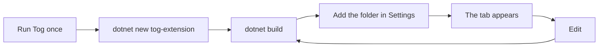

# Writing an extension

A walk-through for building your own extension, from an empty folder to a tab
in the running app. It assumes you can build Tog and nothing else about its
code. [extensions.md](extensions.md) is the reference: every API, how loading
and reloading work, trust and secrets. Come back to it once you have something
running.

An extension is a small Razor class library plus an `extension.json`. Tog loads
it into the running window and loads it again every time you build, so the loop
is edit, build, look.



## Before you start

- A .NET 10 SDK, the same one that builds Tog.
- Tog, run at least once. On every start it copies the API you compile
  against, `Tog.Extensions.dll` with its XML docs, and the project template to
  `~/.tog/sdk/<api>/`, where `<api>` is the API version that copy of the app
  provides (1.13 today). Settings, Extensions, General shows the folder. There
  is no NuGet package: compiling against that folder means you always build
  against the app that will run you.

## The easy way: ask an agent

Agents Tog runs can already write one. Ask for it ("write me an extension that
shows the last CI run for this branch") and the agent calls
`tog_extension_guide`, scaffolds the project, builds it, and asks to add it
with `tog_extension_add`. A prompt appears in the window; nothing loads until
you press *Add and turn on*.

For an agent Tog does not run, Settings, Extensions, General, *Write one with
an agent* has *Copy skill*. Save it wherever that agent reads skills or rules,
or paste it into the conversation. It names this machine's paths and API
version, so copy it again after Tog updates.

The rest of this page is doing it by hand, which is also what the agent does.

## 1. Create the project

Install the template once, from the folder Tog published or from a clone of
this repository, then create a project with a PascalCase name:

```bash
dotnet new install ~/.tog/sdk/1.13/template --force   # or: templates/extension
dotnet new tog-extension -n BuildStatus -o ~/tog-extensions/BuildStatus
```

You get:

| File | What it is |
| --- | --- |
| `extension.json` | The manifest: id, name, version, the API version it needs, the entry assembly and where the build puts it |
| `BuildStatus.csproj` | A Razor class library that references the API with `Private="false"` and builds into `bin/tog/` |
| `BuildStatusExtension.cs` | The one public `ITogExtension`, whose `Configure` registers what the extension adds |
| `BuildStatusView.razor` | A placeholder tab about the agent on screen |
| `assets/extension.css` | Your styles, linked into the page while the extension is loaded |
| `AGENTS.md`, `CLAUDE.md` | The whole API on one page, for you and for any agent working in the folder |

The template's csproj compiles against `~/.tog/sdk/1.0` by default. Point it at
the folder your Tog published, either by changing the `TogSdk` line or on the
command line with `dotnet build -p:TogSdk=$HOME/.tog/sdk/1.13`.

## 2. Build it

```bash
dotnet build ~/tog-extensions/BuildStatus
```

The build must put `BuildStatus.dll` in `bin/tog/`, which is what `entry` and
`output` in `extension.json` point at. `dotnet watch build` rebuilds on every
save.

## 3. Turn it on

In Tog, Settings, Extensions, Extension folders, *Choose folder...* and pick the
project. Or, while developing Tog itself, start it with
`dotnet run --project src/Tog.App -- --extension ~/tog-extensions/BuildStatus`.

If you keep several extensions side by side, add their parent folder once
instead (it is saved as `~/tog-extensions/*`). A new project that appears
there later is off until you say yes to the prompt, since an agent can write
into that folder without asking.

The tab now shows in the right panel. From here every build reloads it in the
open window; nothing restarts. Build errors are in your terminal, load errors
on the extension's card in Settings, and a view that throws shows its error in
the tab with Retry.

## 4. Make it do something

Everything is registered in `Configure`. The common pieces:

```csharp
public sealed class BuildStatusExtension : ITogExtension
{
    public void Configure(IExtensionBuilder builder)
    {
        // Background work while the extension is loaded. A worker is also
        // registered as a singleton, so the view and the tool can take it.
        builder.AddWorker<BuildPoller>("poll");

        // A tab about the worktree on screen, in the left panel (API 1.4).
        builder.AddWorktreeView<BuildView>("build", "Build", ViewLocation.LeftPanel);

        // A short count on that tab, such as failed jobs.
        builder.AddWorktreeIndicator<BuildIndicator>("build");

        // A tool the agents can call, seen as mcp__tog__build_status (API 1.2).
        builder.AddAgentTool<BuildStatusTool>();
    }
}
```

| Want | Register | Write it against |
| --- | --- | --- |
| A tab about an agent | `AddView<T>` | `AgentViewBase` |
| A tab about a worktree, shown with no agent picked too | `AddWorktreeView<T>` (1.4) | `WorktreeViewBase` |
| A count on a tab | `AddIndicator<T>`, `AddWorktreeIndicator<T>` (1.4) | `IAgentIndicator`, `IWorktreeIndicator` |
| Background work | `AddWorker<T>` | `IExtensionWorker` |
| A tool for agents | `AddAgentTool<T>` (1.2) | `IAgentTool` |
| A switch or choice in Settings | `AddSetting` (1.9) | read with `IExtensionSettings` |
| Something drawn over the whole window | `AddOverlay<T>` (1.10) | `OverlayBase` |
| Hover and go to definition for a language | `AddCodeIntelligence<T>` | `ICodeIntelligence`, see [code-intelligence.md](code-intelligence.md) |

A view gets `Agent` or `Worktree` (path, branch, git counts), `IsVisible` and
`Context`. It can `@inject` the API services, `ITogView`, `INavigation`,
`ITextLinker`, `IExtensionStorage`, `ILogger<T>`, and in a view `IEditorTabs`,
`IAgentOffers`, `IDialogs` and `IAgentMessages`. Your own services, and
`ISecrets` and `IExtensionSettings`, come from `Context.Get<T>()`, because
`@inject` resolves from the app's container, not yours.

An agent tool:

```csharp
public sealed class BuildStatusTool(BuildPoller poller) : IAgentTool
{
    public string Name => "build_status";
    public string Description => "The last CI run for the caller's branch: status, failed jobs, link.";
    public string InputSchema => """{ "type": "object", "properties": {} }""";

    public Task<AgentToolResult> CallAsync(AgentToolCall call, CancellationToken ct) =>
        Task.FromResult(call.Cwd is { } folder
            ? new AgentToolResult(poller.Describe(folder))
            : AgentToolResult.Error("No worktree for this agent."));
}
```

`call.Cwd` and `call.AgentId` come from the calling session's own key, so
trust them, and nothing else in the arguments, for who is asking.

## 5. Set the API version

The template declares `"apiVersion": "1.0"`, which every Tog loads. Using
anything newer means raising it to the newest version you use: the version
each member arrived in is in the table above, in the XML docs, and in the
template's `AGENTS.md`. A Tog older than that refuses to load it and says why
in Settings, rather than failing halfway. Never declare a version newer than
the app you run; 1.x only adds, so a newer app always loads an older
extension.

## 6. Look native

Use the app's classes and it will look like the rest of Tog, light and dark:
`card`, `card-head`, `card-body`, `row`, `stack`, `inline`, `chip`, `banner`,
`faint`, `muted`, `mono`, `truncate`, `empty`, and buttons with `primary`,
`ghost` and `small`. Colours are CSS variables such as `--text`,
`--surface`, `--border`, `--accent` and `--danger`. Put your own rules in
`assets/extension.css`, prefixed with the extension's id. The full list is in
the template's `AGENTS.md`.

## Rules that will save you a reload

- **Exactly one public `ITogExtension`** in the entry assembly.
- **Never ship a shared assembly.** Keep the API reference `Private="false"`
  and do not add packages for `Microsoft.AspNetCore.*`,
  `Microsoft.Extensions.*` or `System.*`. A second copy makes your component a
  different type from the app's, and nothing casts.
- **`appliesTo` and an indicator's `For` run on every render.** Answer from
  memory; do the work in a worker or a service and cache it.
- **The view re-renders about once a second.** A view that draws a lot
  overrides `ShouldRender`. `ITogView.Changed` fires on a background thread, so
  update through `InvokeAsync`.
- **Workers stop when `stopping` is cancelled.** A reload waits for them. Never
  start a bare thread: an exception on it ends the app.
- **Agent tools answer quickly.** Start long work and return, with a second
  tool to ask how it is going.
- **Pause timers while `IsVisible` is false.** A view is kept, not disposed,
  when the user switches agents.
- **Anything that changes the user's repository is a button they press**, never
  done on its own. Nothing is written into `~/.claude`. Your data goes in
  `IExtensionStorage`'s folder.
- **Secrets are declared, never given to an agent.** Name each in
  `extension.json` (API 1.12) and prefer `ISecrets.SendAsync`, which adds the
  secret to the request so you never hold it. See
  [extensions.md](extensions.md#secrets).

## Examples to read

- [examples/NodeTests](../examples/NodeTests): a worktree view, a service
  shared by every window, and a process started only from a button.
- [examples/WaitingSign](../examples/WaitingSign): an overlay over the whole
  window, fed by every agent's state.

## Sharing it

There is no marketplace and no download: extensions come from local folders.
Share yours as a repository; whoever uses it clones it, builds it against their
own Tog's SDK, and adds the folder. Since enabling an extension runs its code
inside the app as them, they should read it first.
